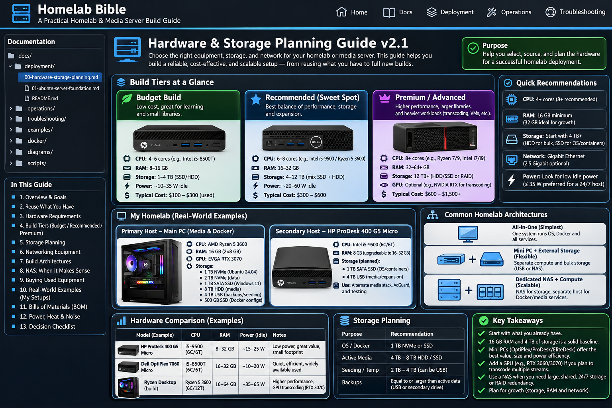

# Homelab Bible

A practical manual for building, operating, and troubleshooting an Ubuntu-based homelab and media server. Start with the deployment gates. Use the operations guides to diagnose the host and services before making changes.

| Start here | Purpose |
| --- | --- |
| [Start Here: Hardware and Storage Planning](docs/deployment/00-hardware-storage-planning.md) | Begin here if you're new. Choose your equipment, understand your storage needs, and plan your first homelab. |
| [Deployment roadmap](docs/deployment/README.md) | Follow installation, storage, Docker, services, recovery and handoff in dependency order. |
| [Ubuntu Server foundation](docs/deployment/01-ubuntu-server-foundation.md) | Prepare an expendable OS disk, install Ubuntu Server 24.04 LTS amd64, and verify first boot. The isolated install rehearsal is pending. |
| [Operations by symptom](docs/operations/README.md) | Find the right guide for storage, Docker, DNS, reachability or logs. |
| [Troubleshooting cases](docs/troubleshooting/README.md) | Interpret verified observations and identify the evidence still missing. |
| [Architecture](diagrams/architecture.md) | See the proposed host, storage, listener and VPN boundaries. |
| [Docker templates](docker/README.md) | Review reconstructed Jellyfin and Gluetun/qBittorrent examples. |
| [Validation matrix](docs/operations/validation-matrix.md) | Check which diagnostics ran in fixtures and which still need a lab. |

## Prerequisites

Use an authorized dedicated host or isolated lab, verified installation media, a known OS disk, console access and known-good backups. Confirm persistent mounts before starting services. The Docker examples require a supported Docker Engine and Compose v2, local state directories, and explicitly selected image versions. Read the roadmap before applying the examples.

**Status:** This is a review-stage repository package. The architecture and Compose templates describe example deployments. The historical baseline and case studies label their own dates and confidence. The Ubuntu installation, Docker runtime and backup restore still need validation. Direct links to internal research attachments are intentionally omitted from this package. Their descriptions remain in the guides; the original project checkpoint preserves the references.

## Using AI as Your Homelab Assistant

You do not need to be a Linux expert to start building a homelab. This guide is designed to work alongside an AI assistant such as ChatGPT.

AI can help you understand commands, troubleshoot errors, and adapt examples to your own hardware. Use it as a learning partner, not as an unquestionable authority.

### How to get useful help

1. **Ask why before running commands.** Have AI explain what a command does, what it changes, and what successful output looks like.
2. **Share error messages.** Copy the relevant terminal output and ask AI to explain the problem before suggesting a fix.
3. **Explain your setup.** Tell AI your operating system, hardware, network design, and what you're trying to accomplish.
4. **Work one step at a time.** Run one command, inspect the result, and verify it before continuing.
5. **Request a recovery plan.** Before changing storage, networking, permissions, or Docker configuration, understand how to recover if something fails.

### Example prompt

> I'm following the Homelab Deployment Bible on GitHub. I'm a beginner using Ubuntu Server 24.04 LTS. Explain each step before giving me commands. Tell me what the command changes, what output to expect, and how to recover if something goes wrong. Give me one step at a time and wait for my results.

### Important safety rules

- Never blindly execute AI-generated commands.
- Never share passwords, API keys, SSH private keys, VPN credentials, or recovery codes.
- Remove sensitive information from logs and configuration files before sharing them.
- Double-check commands that delete files, format disks, change permissions, or modify firewall and SSH settings.
- Verify important instructions against official documentation.
- Stop if an AI suggestion conflicts with a safety warning in this guide.

**Remember:** AI can make mistakes, even when its explanation sounds convincing. The deployment guide provides the process and safety checkpoints. AI helps you understand and troubleshoot your specific setup.
