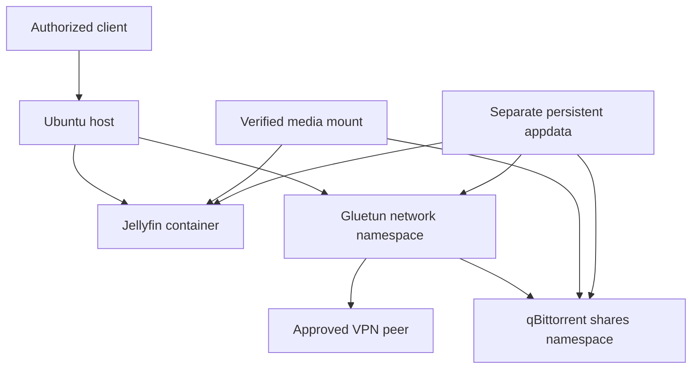

# Conceptual deployment architecture

This is a proposed example. It does not describe a verified current topology.

The Jellyfin template reads media. The download service uses its own approved writable path under the common media root. Both WebUI mappings are loopback-scoped in the draft. A future proxy adds a separate client-to-origin path. Provider forwarding requires its own configuration and validation. See the [Docker examples](../docker/README.md).
