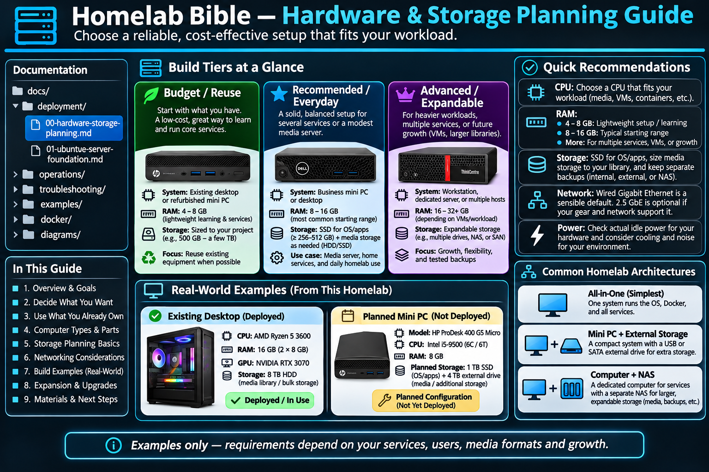

# Stage 1: Hardware and Storage Planning

> **Purpose:** Choose a suitable homelab computer, plan its storage, and check the accessories you need before installing Ubuntu. You do not need enterprise equipment to get started.

*The illustration is a visual overview, not a product photograph or specification sheet. Use the guidance and checklists below when choosing actual equipment.*

## Welcome: Build Your First Homelab

A **homelab** is a computer or group of computers you use at home to run services, store files, and learn technology.

You could use it to:

- **Stream your media** with Jellyfin.
- **Block unwanted domains** across your home network with AdGuard Home.
- **Store and share files** between computers.
- **Practice Linux, networking, and cybersecurity.**
- **Run home automation** and other services.

You can start with an old desktop or a refurbished mini PC. Add storage or upgrade hardware when you have a reason to.

### What you need to get started

1. A working desktop, laptop, or mini PC.
2. A working SSD or hard drive for the operating system.
3. A wired network connection, preferably Ethernet.
4. A USB flash drive for the Ubuntu installer.
5. A monitor and keyboard for initial setup, unless your hardware supports another installation method.

**Our recommendation:** Start with equipment you already own. Learn what your server needs before spending money on upgrades.

## 1. Decide What You Want Your Server to Do

Start with the jobs you want the server to handle. The workload determines the hardware, storage, and budget.

| Your goal | Example application | What matters most |
| --- | --- | --- |
| Watch movies and TV | Jellyfin | Media storage and playback compatibility |
| Block ads at home | AdGuard Home | Reliability and network availability |
| Store and share files | Samba | Storage capacity and backups |
| Learn Linux and cybersecurity | Ubuntu Server and virtual machines | CPU, RAM, and room to experiment |
| Run several applications | Docker | Enough memory and storage for your services |

You can run several services on one computer.

### A few questions to consider

- **How many people will use it?** Several simultaneous media streams or virtual machines may need more resources.
- **Will it run all day?** Consider electricity use, noise, cooling, and where it will sit.
- **How much storage will you need?** A learning server may need very little. A large media library can require several terabytes.
- **What's your budget?** Reusing equipment is often the least expensive option. Remember to include missing accessories, shipping, and tax.

For media servers, two terms are useful:

- **Direct Play:** The playback device can play the file as stored. The server usually does less work.
- **Transcoding:** The server converts media into a format the playback device supports. This can require significantly more processing power.

A dedicated graphics card is not required for every media server. The right hardware depends on the media formats, playback devices, and number of users.

### Planning checklist

- [ ] I know what I want the server to do.
- [ ] I have considered how many people will use it.
- [ ] I know whether it needs to run continuously.
- [ ] I have estimated my storage needs.
- [ ] I have a spending limit.
- [ ] I have checked whether I can reuse a computer.

You do not need every answer yet. The next sections will help you choose suitable equipment.

## 2. Understand the Equipment You Already Own

Before shopping, check whether a computer you already have can do the job.

### Types of computers

| Computer type | Advantages | Things to consider |
| --- | --- | --- |
| Desktop PC | Often easy to upgrade; may have room for more drives | Can use more electricity and space |
| Mini PC | Small, often quiet and efficient | Limited internal storage and expansion |
| Laptop | Built-in screen, keyboard, and battery | Cooling, battery condition, and limited upgrades |
| Dedicated server | Designed for expansion and heavier workloads | Can be expensive, noisy, and power-hungry |

**Beginner tip:** A working spare desktop or mini PC is often enough to learn Linux and run a few services.

### Computer parts in plain English

| Component | What it does | Why it matters |
| --- | --- | --- |
| CPU (processor) | Runs instructions and performs calculations | Affects how much work the server can handle |
| RAM (memory) | Holds information applications are currently using | More services and virtual machines generally need more RAM |
| SSD | Stores the operating system and application files | Usually provides faster access than a hard drive |
| HDD | Stores files on spinning magnetic disks | Often offers more capacity for the money |
| Ethernet | Connects the computer to your network | Wired connections are a reliable choice for servers |
| SATA / NVMe | Connects internal storage devices | Determines which drives the computer can use |
| USB | Connects external devices and storage | Useful for external drives and installation media |
| BIOS/UEFI | Starts and configures hardware before the operating system loads | Provides boot and hardware settings |

### How much hardware do you need?

These are broad starting points, not guaranteed requirements.

| Project | RAM starting point | Storage considerations |
| --- | --- | --- |
| Basic Linux learning server | 4–8 GB | A modest SSD may be enough |
| AdGuard Home and lightweight services | 4–8 GB | Reliability matters more than capacity |
| Jellyfin media server | 8–16 GB | Depends on media size and transcoding needs |
| Several Docker applications | 8–16 GB or more | SSD for application data; add media storage as needed |
| Virtual machines and larger labs | 16–32 GB or more | Depends on the number and size of VMs |

Check the requirements of the applications you plan to run. CPU needs vary with workload.

### Check a computer before buying or reusing it

On Windows 11, open **Settings → System → About** to see the processor and installed memory. Use **Disk Management** to inspect storage devices.

On Ubuntu, these read-only commands show basic hardware information:

    lscpu
    free -h
    lsblk -o NAME,SIZE,TYPE,MODEL

They display information; they do not format or erase drives.

### Example: Refurbished mini PC

A business mini PC such as an HP ProDesk, Dell OptiPlex Micro, or Lenovo ThinkCentre Tiny can make a compact home server.

For any used mini PC, check the exact model, processor, RAM, power adapter, SSD, drive caddy, and any proprietary SATA cable. Do not assume an online listing includes parts that are not shown.

### Don't forget the accessories

- [ ] Compatible power adapter and cable
- [ ] SSD or HDD, if one is not included
- [ ] Drive caddy, bracket, or required SATA cable
- [ ] Ethernet cable and an available router or switch port
- [ ] USB flash drive for installation
- [ ] Monitor and keyboard for initial setup, if needed
- [ ] Separate backup storage for important files

### Your hardware inventory

| Component | What you have | Upgrade or accessory needed? |
| --- | --- | --- |
| Computer model | | |
| Processor (CPU) | | |
| Installed RAM | | |
| Operating system drive | | |
| Additional storage | | |
| Ethernet connection | | |
| Power adapter | | |
| Drive connections / caddy | | |
| Backup storage | | |

## 3. Choose Your Homelab Setup

There is no single perfect homelab. Choose based on what you own, what you want to run, how much storage you need, and how much you want to spend.

You can run many services on one computer. A separate NAS, rack, or dedicated server is optional.

### 3.1 Option A: Reuse an Existing Desktop or Laptop

**What it is:** Use a working computer you already own.

**Good for:** Learning Ubuntu, trying Docker, AdGuard Home, file sharing, and a modest Jellyfin setup.

**Advantages:** Lowest purchase cost if you already own suitable equipment. Desktops may have room for more drives and memory.

**Trade-offs:** Reboots interrupt services. Older machines may use more electricity or make more noise. Laptops need suitable cooling and attention to battery condition.

**Beginner verdict:** A good first choice if you have a spare computer.

### 3.2 Option B: Refurbished Mini PC

**What it is:** A small business computer, such as an HP ProDesk/EliteDesk Mini, Dell OptiPlex Micro, or Lenovo ThinkCentre Tiny.

**Good for:** Always-on DNS filtering, Linux practice, Docker applications, and modest media serving.

**Advantages:** Compact, often quiet, and easy to place at home.

**Trade-offs:** Limited internal drive bays and upgrade options. Used listings may omit the power adapter or drive hardware.

**Beginner verdict:** A strong option for a compact, dedicated server.

### 3.3 Option C: Computer with External USB Storage

**What it is:** The computer runs applications while an external drive stores larger files such as movies and photos.

**Good for:** A media library when the computer has limited internal drive space.

**Advantages:** Easy to add storage without replacing the computer.

**Trade-offs:** Cables, power supplies, and enclosures can fail or disconnect. A disconnected drive can interrupt applications. An external drive is not automatically a backup.

**Beginner verdict:** Practical for a small setup when the drive is mounted reliably.

### 3.4 Option D: Computer Plus NAS

**NAS** means **Network-Attached Storage**. It is a device or computer that makes storage available to other devices over your home network.

In this setup, one computer runs applications while the NAS provides shared storage.

**Good for:** Large media collections or several computers that need access to the same files.

**Advantages:** Centralized storage and room to expand, depending on the NAS.

**Trade-offs:** Additional cost and configuration. Network shares need permissions and reliable connections. If the NAS is offline, applications that depend on it may lose access to files.

**Important:** A NAS is not automatically a backup. RAID can help a system continue after certain drive failures, but it does not protect against accidental deletion, malware, theft, or every hardware failure.

**Beginner verdict:** Consider a NAS when you have a real need for shared storage. It is not a required first purchase.

### 3.5 Option E: Dedicated Server or Advanced Build

**What it is:** A workstation, rack server, or multi-computer setup designed for heavier workloads or expansion.

**Good for:** Multiple virtual machines, larger storage systems, and more demanding labs.

**Advantages:** More room for expansion and, depending on the equipment, more drive bays and management features.

**Trade-offs:** Higher cost, electricity use, noise, heat, and maintenance.

**Beginner verdict:** Upgrade when your actual workload justifies it.

### 3.6 Quick Comparison

| Setup | Cost | Space | Best starting use |
| --- | --- | --- | --- |
| Reused desktop/laptop | Often lowest | Varies | Learning and testing |
| Refurbished mini PC | Budget-friendly | Small | Lightweight always-on services |
| Computer plus USB storage | Host plus drive | Small to medium | Home media library |
| Computer plus NAS | Higher | Multiple devices | Shared storage |
| Dedicated server | Often highest | Medium to large | Larger labs and virtual machines |

These are general comparisons, not live prices. Check the exact model, total delivered cost, electricity use, and compatibility before buying.

### 3.7 Example Equipment Lists

**Starter setup**
- Working desktop or laptop
- Healthy SSD
- Ethernet cable
- USB installation drive
- Separate backup for important files

**Compact dedicated server**
- Refurbished mini PC with compatible power adapter
- 8 GB RAM as a modest starting point; 16 GB gives more room
- SSD for Ubuntu and application data
- Ethernet cable and USB installation drive

**Media server**
- Suitable desktop or mini PC
- SSD for Ubuntu and application settings
- Internal or external media drive
- Separate backup for important files
- Optional UPS for temporary battery power during an outage

**NAS-based setup**
- Computer to run applications, unless the NAS will run them
- NAS enclosure and compatible drives
- Wired network connection
- Separate backup destination

### 3.8 Real-World Examples

**Existing Ubuntu desktop:** An AMD Ryzen 5 3600 system with 16 GB RAM, an RTX 3070, SSD/NVMe storage, and an 8 TB media drive is an example of reusing an existing computer. It can host services, but dual-boot reboots interrupt them. This is an example, not a required specification.

**Planned HP ProDesk 400 G5 Micro:** An Intel Core i5-9500 mini PC purchased with 8 GB RAM, with a planned 1 TB internal SSD and 4 TB external USB drive, is an example of a compact dedicated host. Verify the power adapter and required drive hardware before deployment. This is a plan, not a completed benchmark.

### 3.9 Choose Your Setup

- [ ] I chose a starting computer or hardware type.
- [ ] I checked the exact model and included accessories.
- [ ] I identified where Ubuntu and application data will live.
- [ ] I identified where larger files will live, if needed.
- [ ] I have a separate backup plan for important files.
- [ ] I considered electricity, noise, space, and future expansion.
- [ ] I know the total delivered cost before buying.

## 4. Plan Your Storage

A simple homelab usually has three types of data:

1. **Ubuntu:** The operating system.
2. **Application data:** Docker settings, databases, and configuration files.
3. **Personal files:** Movies, photos, documents, and other files.

For a beginner, an SSD for Ubuntu and applications plus a larger drive for media is a useful arrangement. You can start with one drive if that is what you have.

| Storage | Typical purpose |
| --- | --- |
| SSD | Ubuntu and application data |
| HDD or external drive | Large media and file collections |
| Separate backup drive | Copies of important files and configurations |

The capacities depend on your needs. These are roles, not minimum sizes.

### Where Linux puts your drives

Linux uses one directory tree instead of Windows-style drive letters. Additional drives are attached to folders called **mount points**.

For example, a media drive might be mounted at `/mnt/media`, making its files available under `/mnt/media/movies`.

Creating a folder does not mount a drive there. The Ubuntu installation guide will show how to identify a drive and mount it safely.

### Storage safety basics

- Identify a drive by its model and capacity, not just a name such as `/dev/sdb`.
- Check whether a drive contains data before changing it.
- Keep a separate backup of files you cannot replace.
- RAID is not a substitute for a backup.
- Make sure required drives are mounted before starting applications that use them.

**Do not format or erase a drive during this planning stage.** The installation guide will cover disk identification, partitioning, and mounting step by step.

## 5. Network and Accessories

A wired **Gigabit Ethernet** connection is a sensible starting point for one home server.

You do not need a managed switch, VLANs, or 2.5 GbE to build your first homelab. Add them when you have a specific reason.

Before setup, check:

- Your router or switch has an available Ethernet port.
- You have a suitable Ethernet cable.
- The server can be placed somewhere with ventilation.
- You have the power adapter and storage accessories required by the computer.
- A UPS is worth considering if unexpected power loss could interrupt important services.

## 6. Inspect Used Equipment Before Buying

Before purchasing a refurbished computer:

- Confirm the exact model and processor.
- Check RAM capacity and upgrade options.
- Confirm the power adapter is included.
- Check whether the SSD, drive caddy, and SATA cable are included.
- Review seller photos, return policy, shipping, and taxes.
- Check for BIOS locks or other restrictions when possible.

When it arrives, inspect the ports and fans, confirm it boots, check storage health, and verify the Ethernet connection.

**Do not assume a used computer includes an SSD, power adapter, or operating system unless the listing says so.**

## 7. Example Homelab Builds

These examples show two ways to approach a home server. They are reference configurations, not required shopping lists.

**Reuse-first desktop:** An AMD Ryzen 5 3600, 16 GB RAM, RTX 3070, SSD/NVMe storage, and 8 TB media drive. This uses hardware already available, but desktop reboots interrupt services and power use may be higher than a small mini PC.

**Compact secondary host:** An HP ProDesk 400 G5 Micro with an Intel Core i5-9500 and 8 GB RAM at purchase. The planned configuration adds a 1 TB internal SSD and 4 TB external USB drive. Verify the power adapter and drive mounting parts before installation. Planned services should not be described as deployed until they have been installed and tested.

## 8. Build Your Equipment List

Use this worksheet to estimate the total cost before ordering anything.

| Item | Needed? | Existing model / details | Cost |
| --- | --- | --- | --- |
| Desktop or mini PC | Yes | | |
| Power adapter / drive caddy / cable | If missing | | |
| SSD for Ubuntu and applications | If needed | | |
| Media storage | Depends on project | | |
| Separate backup storage | Recommended | | |
| USB enclosure or NAS | If needed | | |
| Ethernet cable or switch | If needed | | |
| UPS | Optional | | |

**Remember to include shipping and tax.** A low advertised price can become a less attractive deal when essential accessories are missing.

## 9. Ready for the Ubuntu Installation?

Before moving to the next stage, check that:

- [ ] I know what I want the server to do.
- [ ] I chose a suitable computer.
- [ ] I checked the computer's specifications and accessories.
- [ ] I know which drive will hold Ubuntu.
- [ ] I know where application data and personal files will go.
- [ ] I have a backup plan for important data.
- [ ] I have considered network access, power, cooling, and placement.
- [ ] I know the total cost, including required accessories.

**Next:** Continue to [Stage 2: Ubuntu Server Foundation](01-ubuntu-server-foundation.md).

> **Before installing:** Never select a disk based only on an example device name. Identify the actual drive by its model, capacity, and contents before making changes.
