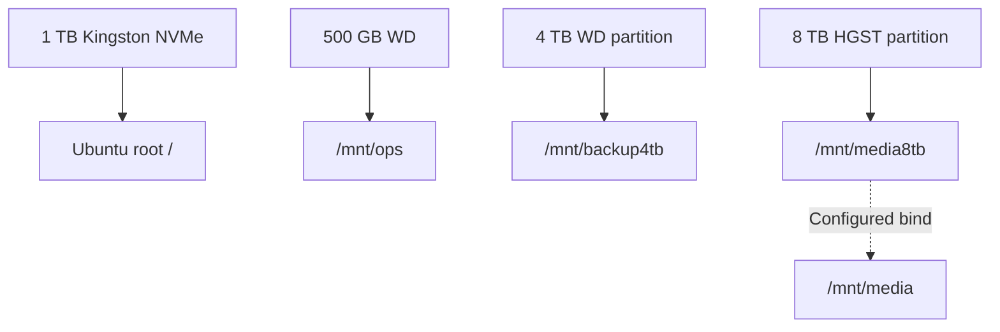

# Homelab Bible — Historical Hardware, Storage and Topology

**Pilot draft · Batch 10 · November 15, 2026**

Use each row as a dated snapshot. **Observed** identifies direct technical evidence. **Configured** identifies saved configuration text. **Reported** identifies a user description or indexed excerpt. **Planned** identifies intended work. Host addresses, disk serials and UUID values are omitted.

| Date and evidence | Component | Snapshot and limits |
| --- | --- | --- |
| March 21 CDT / March 22 UTC · Observed and configured | Ubuntu boot and local disks | `nvme0n1p1` backed ext4 `/` on the 1 TB Kingston NVMe. `nvme1n1p1` on the 2 TB Nextorage NVMe held the mounted EFI partition, configured as vfat. The 1 TB Samsung SATA SSD had a partition mounted under the desktop user's media directory. This capture does not establish the Windows boot path. March capture, lines 8–16 and 40–54 (private research record) |
| March 21–22 · Observed and configured | Media and operations | The 8 TB HGST `sdd1` appeared at `/mnt/media8tb` and was configured as ext4 by UUID. The 500 GB WD `sda` backed `/mnt/ops`, also configured as ext4 by UUID. The 4 TB WD `sdc1` appeared at `/mnt/backup4tb`. The capture establishes the mount point for the 4 TB partition. Its filesystem is left unspecified here. March capture, lines 14–16 and 40–47 (private research record) |
| March 21–22 · Configured | Media alias | `fstab` defines a bind from `/mnt/media8tb` to `/mnt/media`. A bind exposes an existing tree at a second path without allocating a second copy of its contents. This entry documents intended persistence. Verify the live alias independently for later dates. March capture, line 16 (private research record) |
| March–September · Reported | Storage roles and media paths | March records describe using the 4 TB for downloads/seeding and temporary photo backup. July excerpts describe separate container binds for `/downloads`, `/tv`, and `/movies`. September excerpts describe a common media root bind at `/data` for the download/import services, with `/data/downloads`, `/data/tv` and `/data/movies`. The later audit script independently uses that path convention. An original saved Compose revision remains missing. Research ledger, Batches 04–05 (private research record) · Audit source (private research record) |
| September 23 UTC · Observed | Portainer | Docker bridge mode, image tag `lts`, Docker socket bind, and named volume `portainer_data` mounted at `/data`. This is Portainer app data. The same container path in a media service can lead to a different host directory. Portainer inspect, lines 37, 47 and 165–175 (private research record) |
| December 2025, September and October 2026 · Reported | VPN namespace | Dated December and September Compose excerpts use `container:gluetun`. The October Proton excerpt uses `service:gluetun`. One October runtime comparison reported a shared namespace for Gluetun and qBittorrent. The evidence does not extend that runtime finding to every listed media service. Research ledger, Batches 03–05 (private research record) · [Compose networking reference](https://docs.docker.com/compose/how-tos/networking/) |
| October 3 CDT · Observed | Gluetun startup | VPN startup, tunnel input rules and repeated healthcheck-driven restarts appear in the saved log. These rules describe the tunnel interface. Host port publication and VPN provider forwarding each need independent evidence. Gluetun log, lines 2–22, 38 and 71 (private research record) |
| November 6 · Reported | Primary desktop | Ryzen 5 3600, 16 GB DDR4, RTX 3070, 8 TB HGST, Windows/Ubuntu dual boot and gigabit Ethernet. Ubuntu 24.04 appears in indexed July history. Treat the hardware description as user-reported, and retain the March disk map under its own date. Planning source, lines 56–69 (private research record) · Batch 04 timeline (private research record) |
| November 13–14 CST · Observed | Jellyfin | Startup logs identify version 12.4.0 and container media paths `/tv` and `/movies`. Host source paths and a reverse-proxy network map were not established by these logs. November 13 log (private research record) · November 14 log (private research record) |
| November · Planned | HP ProDesk migration | Intended fresh Ubuntu setup on an existing SSD, external 4 TB attachment, network access to primary-host media and a fresh AdGuard configuration. Media-service placement and exact HP inventory remain provisional. Verify boot, disk detection, mount persistence and DNS from a client before recording a completed migration. Planning source (private research record) · Batch 05 timeline (private research record) |

## Historical architecture diagram — March 2026 host storage only

Arrows connect observed disk devices to mounted paths or the explicitly configured bind alias. This diagram is scoped to the March capture.

March fstab and device listing (private research record)

## Before recording a later baseline

Collect one timestamped set of OS version, block-device identity, live mounts, Docker mount and network fields, and application listener evidence. An indexed configuration or a working application on one date can be cited within that date's scope. The November Jellyfin host binds, full VPN service membership, forwarding reachability and HP deployment need new evidence.
