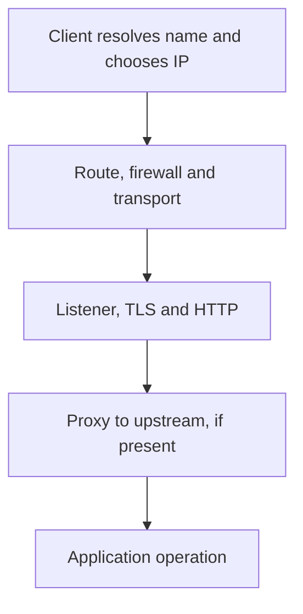

# Network Reachability and Service-Path Diagnostics: A Beginner's Guide

**Deployment & Operations Playbook · Standalone draft · Batch 16 · November 15, 2026**

Start from the affected client. Record the name, expected protocol and port, time zone, and whether the client is local, on the LAN, on a VPN, or external. The passive commands read local state. Active probes send traffic and can leave logs. Run the active examples only against your own authorized disposable endpoints. The example addresses and names are synthetic unless marked as a fixture result.

## 1. Follow the request



| Stage | What a successful observation establishes | What remains open |
| --- | --- | --- |
| Name resolution | The tested resolution path returned one or more records. | Which address and resolver the application used. See the [DNS chapter](dns-diagnostics.md). |
| Address selection | The client attempted a particular IPv4 or IPv6 destination. | The other address family may behave differently. A and AAAA are address types regardless of DNS transport. |
| Route | The kernel selected a device, source and possibly a next hop in this namespace. | Delivery, reverse route and remote state. |
| Firewalls | A matched permitted flow demonstrates that traffic passed the observed path for that attempt. | Other directions, ports, sources and address families. Local outbound and remote inbound policy can differ. |
| Transport | A completed TCP handshake shows a responding TCP endpoint on the path. A valid UDP response shows the tested datagram exchange. | Backend identity, authentication or app health. UDP has no TCP-style handshake. Silence is ambiguous. |
| Listener | A visible socket shows an application or intermediary accepted a bind in that namespace. | Reachability from a different client, forwarding rules and application readiness. |
| TLS | A verified handshake establishes certificate trust and name validation for the intended peer under the test's trust policy. | HTTP routing, backend health and playback. |
| HTTP | The client received a response for that request. | A proxy may have generated it. A status code may not represent the whole body or an app operation. |
| Proxy upstream | Matched proxy and backend logs can show that a request reached its intended origin. | Whether all paths, clients and subsequent requests work. |
| Application | A completed authorized operation, such as sustained playback, validates that workflow at that time. | Long-term reliability or other workflows. |

A local loopback connection stays in its network namespace, the network view used by a process. A same-subnet destination commonly uses a directly connected route. A remote destination often uses a default gateway unless a more specific route or policy applies. VPNs can select another interface, DNS path, or policy table. Test from the actual caller's view.

**NAT** changes addresses or ports. Port forwarding maps an incoming address and port to a destination. Router forwarding, Docker host publication and a VPN provider's inbound lease are separate mappings. A LAN success does not show that an external client can reach the service. A reverse tunnel can use an outbound connection and has its own origin configuration. A host listener, an internal container listener, and a Docker published port answer distinct questions. [Docker diagnostics chapter](docker-diagnostics.md) · [Linux route manual](https://man7.org/linux/man-pages/man8/ip-route.8.html)

## 2. Routing, sockets, TLS and HTTP commands

Use an authorized Linux client for route checks, and an authorized host or caller namespace for socket checks. Replace `192.0.2.20` only with an authorized destination. The active HTTPS commands are scoped to a loopback fixture with a SAN for `proxy.lab.test`, a dedicated certificate at `./fixture-cert.pem`, and example port 8443. Substitute the actual disposable listener port. The explicit curl override fixes the tested address while preserving the URL hostname and its TLS and HTTP identity. It bypasses ordinary DNS for that request. The shell redirects OpenSSL stdin from an empty stream to avoid interactive input.

```bash
ip address show
ip route show
ip route get 192.0.2.20
ip -6 route show
ping -c 2 127.0.0.1
tracepath -n 127.0.0.1
ss -lnt
ss -lnu
ss -tn state established
curl --noproxy '*' --connect-timeout 2 --max-time 5 --resolve proxy.lab.test:8443:127.0.0.1 --cacert ./fixture-cert.pem -sS -o /dev/null -w 'HTTP %{http_code}\n' https://proxy.lab.test:8443/health
openssl s_client -connect 127.0.0.1:8443 -servername proxy.lab.test -verify_hostname proxy.lab.test -verify_return_error -CAfile ./fixture-cert.pem -brief </dev/null
docker container logs --since 10m --tail 100 --timestamps demo-proxy
```

**QA labels:** S means shell syntax and technical references reviewed, runtime pending. B15 records prior workspace restriction for that invocation. F12 and F16 indicate disposable fixture validation only. All lines were syntax checked.

| Command | Prerequisites and permissions | Expected result, concerning result and next safe step | Scope / QA |
| --- | --- | --- | --- |
| `ip address show` | iproute2 and allowed netlink, normally regular user. | Look for expected interface, address and prefix. Missing interface/address or permission errors warrant checking namespace and client context before drawing a conclusion. | Passive / S |
| `ip route show` | iproute2 and allowed netlink, normally regular user. | Connected routes and an expected default may appear. This primarily displays the IPv4 main table. Check destination lookup and policy context if needed. | Passive / B15 netlink denied |
| `ip route get 192.0.2.20` | iproute2, authorized namespace and netlink, normally regular user. | Example: device/source with or without `via`. An unexpected gateway or tunnel is a routing clue. Match the app's source and policy. This asks the kernel for a route and does not send a network probe. | Local lookup / S |
| `ip -6 route show` | Same access. | Check IPv6 connected and default routes. A missing IPv6 route can explain IPv6 failures when the IPv4 path works. Check selected address and scope. | Passive / S |
| `ping -c 2 127.0.0.1` | iputils and permitted ICMP socket access. Usually no elevation on configured hosts. | Replies show ICMP exchange for this test. Permission denial or absent replies cannot establish TCP/HTTPS failure. Scope any subsequent test to an authorized port. | Active / S, unavailable here |
| `tracepath -n 127.0.0.1` | tracepath and permitted UDP and error-queue access, commonly regular user. | Shows observed path responses or gaps. A gap may reflect filtered diagnostic replies. Loopback exercises the tool only. Use an authorized local destination if tracing a real lab route. Traceroute is an alternative with different modes and permissions. | Active / S, unavailable here |
| `ss -lnt` | iproute2 and namespace visibility, normally regular user. | TCP LISTEN on expected address and port. `127.0.0.1` is loopback. `0.0.0.0` is IPv4 wildcard, `[::]` is IPv6 wildcard, and dual-stack behavior can vary. Check stderr and container scope. | Passive / F12, netlink limit |
| `ss -lnu` | Same access. | Bound UDP can appear UNCONN in normal operation. A matching local socket does not establish an exchange. Check protocol, address and namespace. | Passive / F12, netlink limit |
| `ss -tn state established` | Same access. | Lists currently established TCP connections in scope. An empty snapshot may simply miss short-lived flows. Compare timestamps and relevant listener. | Passive / S |
| curl above | curl, loopback fixture, readable certificate, regular user. | Example: `HTTP 200`, or `HTTP 502` with exit 0 by default if transfer succeeds. Preserve stderr and exit status. `--fail` can convert HTTP error responses into exit 22. The example discards the body and does not follow redirects. Inspect the response and Location in an authorized follow-up if needed. | Active / F16, dynamic fixture port |
| OpenSSL above | openssl, readable test CA/cert and loopback listener, regular user. | Example: `Verification: OK`. A trust/name error is a TLS-stage finding. Keep verification enabled. Check intended name, chain and clock. This verifies TLS without demonstrating HTTP or backend success. | Active / F16, dynamic fixture port |
| `docker container logs --since 10m --tail 100 --timestamps demo-proxy` | Docker CLI, authorized Engine access and accessible logs for an existing test container. | Expect timestamped log records. No output can mean wrong window, driver or logging destination. Inspect the known backend's logs in the same interval and correlate sanitized request IDs. | Passive / S, Docker runtime still pending |

**TLS terms:** The handshake negotiates a secure connection. Trust validation checks the presented certificate chain against a configured trust source, its validity period and hostname. **SNI** tells a server which hostname's TLS configuration to select. Sending SNI and verifying the certificate name are separate. A redirect is an HTTP instruction for another URL. Follow only expected targets and assess their TLS separately. [curl manual](https://curl.se/docs/manpage.html) · [OpenSSL s_client manual](https://docs.openssl.org/3.5/man1/openssl-s_client/) · [HTTP semantics](https://www.rfc-editor.org/rfc/rfc9110.html)

## 3. Quick reference by symptom

| Result | Likely investigation boundary | Next safe evidence |
| --- | --- | --- |
| DNS failure | Resolver, record or client namespace | Compare ordinary and explicit lookup results before transport tests. |
| Connection refused | Rejection along TCP path, often no matching listener or explicit reject | Check destination/port, namespace and listener or firewall evidence. |
| Connection timeout | No completion before deadline, possibly drops, route issues or a stalled stage | Identify whether connect, TLS or response wait timed out. Compare source path and logs. |
| TLS validation failure | Certificate chain, name, SNI, validity time or trust policy | Compare certificate and intended URL name and client clock. Preserve verification. |
| HTTP 404 | Responder did not find the target resource or chose not to disclose it | Confirm Host, route and path in responder logs. A 404 can come from the proxy. |
| HTTP 502 | A gateway reports an invalid upstream response. Refused origin connections, DNS errors or upstream TLS problems can appear as 502 in implementations. | Read the actual gateway error and correlate the request with backend evidence. |
| HTTP 503 | Responder reports temporary unavailability | Check maintenance, saturation, health and Retry-After if provided. |
| HTTP 504 | A gateway reports an upstream timeout | Find which upstream stage timed out. Compare request duration and backend logs. |
| HTTP 200 with app failure | HTTP request returned success at that endpoint | Inspect intended operation, response contents and client logs. A health endpoint is not playback. |

A **listening** TCP socket waits for connection attempts. An **established** socket represents a specific connection. Either can exist without a successful application transaction.

## 4. Synthetic walkthrough · DNS works, proxy returns 502

1. **DNS and selected address.** On the affected lab client capture the ordinary name response and the address actually used. In this scenario the approved proxy IP matches. A curl fixture override would test a separate question and cannot prove normal resolution.
2. **Client route.** Inspect the selected destination route. Record device, source and gateway. If a VPN is active, check its scope before comparing local and external paths.
3. **Proxy listener.** Inspect sockets from the proxy's network view and any host publication separately. In this example an expected TLS listener is present.
4. **TLS and HTTP.** The verified hostname and trusted certificate show the client reached a matching frontend. The 502 confirms an HTTP responder returned a gateway error.
5. **Origin target.** Read the authorized proxy settings and logs. Example: the configured origin is loopback, but the proxy and backend use different namespaces. That is one candidate. Other candidates include missing name resolution, a stopped backend, wrong port/protocol or an upstream TLS problem.
6. **Backend state and listener.** Use the [Docker chapter](docker-diagnostics.md) to compare effective membership, status and timestamps. Check the backend listener from its own view. A running container can have no ready app socket. Compare the backend's expected port and binding to the origin configuration.
7. **Match logs.** Record first error, origin scope, and whether a request ID appears in backend logs. Absent backend logs do not establish the reason without checking log coverage.
8. **Stop before changes.** Record the candidate cause and what would falsify it. After separate authorization for any correction, validate from the original client using ordinary DNS, intended route, verified TLS and the actual app workflow. Capture a matched successful proxy/backend response. No repair or end-to-end proxy test was executed here.

**Decision rule:** If name resolution fails, start there. If resolution works and connection fails, compare route, policy and listener. If the connection succeeds and TLS fails, investigate identity and trust. If HTTP responds, find who generated the status and whether the backend saw the request. Close only the particular workflow you validated.

## 5. Historical homelab examples

| Date and source | Observation | Limit |
| --- | --- | --- |
| Nov 13–14, 2026 CST · Jellyfin Nov 13 (private research record) and Nov 14 (private research record) logs | Earlier bind-override warning alongside listener output. Later log shows all-interface listener startup. | Paired XML, matched Cloudflare Tunnel ingress/origin and end-to-end playback are missing. Historical Tunnel usage is reported in the project ledger (private research record). Do not infer which backend path the tunnel used from Jellyfin listener output. |
| Oct 3, 2026 CDT · Gluetun startup log (private research record) | Logs show VPN healthcheck restarts and DNS failures around those events. | Timing does not establish a cause, complete VPN routing, or provider ingress/reachability. Tunnel and Docker lifecycle differ. |
| Nov 12–13, 2026 · ASUS error capture (private research record) and later router capture (private research record) | Earlier MDIO errors, later capture without those errors and DHCP activity. | Different windows. Actual WAN fault, persistence and client DNS behavior remain open. |
| Sep 10, 2026 CDT · Shelfarr log (private research record) | Search stream returned 502 at 17:59:11 and 200 at 17:59:19. A nearby upstream rate-limit message provides another lead. | Endpoint-level recovery in one window. Root cause and durability unverified. |
| May 11–12, 2026 · Immich case record (private research record) and May screenshot (private research record) | Indexed database/Redis hostname failures and later direct healthy component state. | Effective Compose change and hostname causality remain unverified. A successful database query doesn't validate every path. |

## 6. QA and evidence handoff

The loopback fixture used curl 8.14.1 and OpenSSL 3.5.7, with a temporary certificate trusted only for the test. It returned synthetic HTTP 200 and 502, both exit 0 on complete transfers. The 502 with `--fail` returned exit 22. After closing the listener, curl returned exit 7 and HTTP 000, which means no HTTP status was received. The initial fixture omitted Content-Length and produced exit 56 after reading response headers. Adding Content-Length let curl complete the transfer. OpenSSL verified the expected name and rejected a deliberately wrong hostname with exit 1. The listener and temporary credentials were removed. The fixture itself generated the 502. It did not exercise real proxy forwarding or any owner endpoint.

Record date and time zone, client and namespace, destination and selected address family, command and versions, scoped stdout/stderr and exit status, responder, request ID and the last verified stage. Redact credentials, private endpoints and logs before sharing. Keep historical data, fixture results and live recommendations distinct. [Validation matrix and reusable checklist](validation-matrix.md)
